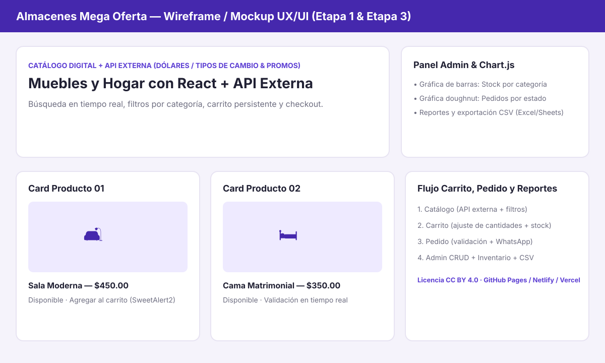

# Aplicación Web - Almacenes Mega Oferta
## ENTREGA FINAL — Proyecto Web Completo (30%: 20% Entrega + 10% Defensa)

Proyecto académico para **DAW901 G01T — Universidad Don Bosco** (Unidad 5, semanas 17–20).  
**Fecha de entrega:** Domingo 22 de noviembre de 2026 / 11:00 pm  
**Defensas virtuales:** Semana del 23 al 27 de noviembre de 2026

### Integrantes y Ramas de Trabajo en GitHub
Cada integrante cuenta con su rama individual en el repositorio público de GitHub, participa como colaborador activo con commits verificables y aporta a la integración en `main`:
- **CR260027** Edwin Andrés Crespin Rivera — Rama sugerida: `rama/edwin-crespin-cr260027`
- **AG253407** Sonia Magaly Alfaro Granados — Rama sugerida: `rama/sonia-alfaro-ag253407`
- **TH260411** Rodrigo José Tobar Huezo — Rama sugerida: `rama/rodrigo-tobar-th260411`
- **HR260143** Erick Alejandro Hernández Rodríguez — Rama sugerida: `rama/erick-hernandez-hr260143`
- **LG260389** Roció Marisol López Gómez — Rama sugerida: `rama/rocio-lopez-lg260389`

> **Nota de cátedra:** Todo integrante debe aparecer como colaborador en GitHub y contar con commits en su rama e historial del repositorio.

### Tecnologías y Arquitectura Implementada
- **HTML5 & CSS3** (diseño *responsive* coherente con los mockups de Figma de la Etapa 1)
- **Bootstrap 5.3** (componentes UI, grillas y navegación adaptable)
- **Framework JS React 18 (vía CDN / Babel + arquitectura React en toda la aplicación)** integrado mediante `js/react-app.js` y montado en las vistas principales para renderizado reactivo de estado, catálogo, métricas y flujo interactivo sin romper los módulos existentes
- **Consumo de API Externa (`open.er-api.com` / `frankfurter.app` con respaldo local)** integrado al flujo del catálogo y pedidos para consultar tasas de referencia / conversión o indicadores externos en tiempo real
- **Chart.js 4** (gráficas dinámicas de inventario por categoría y pedidos por estado en el dashboard)
- **SweetAlert2** (diálogos de confirmación, alertas y notificaciones de resultado)
- **Persistencia en `localStorage`** y exportación **CSV** compatible con Excel, Google Sheets y LibreOffice Calc

### Mockups y Diseño UX/UI (Etapa 1 -> Entrega Final)
Se conserva la identidad visual, paleta, tarjetas de producto y flujo de navegación definidos en los mockups de Figma de la Etapa 1:

- **Paleta y estilo:** Morado principal (`#5d3fd3` / `#4528ad`), superficies limpias (`#f5f3fb` / `#ffffff`), bordes suaves (`#e7e3f2`) y adaptación móvil/escritorio.
- **Flujo completo:** Catálogo con búsqueda/filtros + consulta de API externa -> Carrito con control de existencias -> Confirmación de pedido y envío por WhatsApp -> Panel administrativo (Dashboard con gráficas Chart.js, CRUD de productos, control de inventario, gestión de pedidos y reportes con exportación CSV).

### Credenciales de demostración
- **Administrador:** `admin@megaoferta.com` / `Admin123`
- **Cliente:** Registro libre desde `registro.html` o acceso directo al catálogo y carrito.

### Estructura del Proyecto
- `index.html`: catálogo principal, filtros, estado React y widget de API externa.
- `login.html`: autenticación de usuarios.
- `registro.html`: registro de clientes con validaciones avanzadas.
- `carrito.html`: gestión de cantidades, validación de stock y resumen.
- `pedido.html`: formulario de confirmación y generación de pedido (`MO-XXXX`).
- `Investigacion_Librerias_JS_APA7.pdf`: documento de investigación con referencias APA 7.
- `docs/mockups/mockup_arquitectura_uxui.svg`: mockup/diagrama UX/UI publicado en el repositorio.
- `LICENSE`: licencia **Creative Commons Attribution 4.0 International (CC BY 4.0)**.
- `admin/dashboard.html`: indicadores, gráficas dinámicas con Chart.js y accesos rápidos.
- `admin/productos.html`: crear, listar, actualizar y eliminar productos.
- `admin/inventario.html`: ajuste y control de existencias.
- `admin/pedidos.html`: seguimiento y cambio de estados de pedidos.
- `admin/reportes.html`: resumen por categoría y exportación de inventario/pedidos en CSV.
- `js/react-app.js`: integración de **React 18** y consumo de **API externa** en el flujo del sistema.
- `js/app.js`, `js/auth.js`, `js/catalogo.js`, `js/carrito.js`, `js/pedido.js`, `js/admin.js`, `js/reportes.js`: lógica modular de la aplicación.

### Despliegue en Hosting Gratuito y Publicación en GitHub
1. Subir el proyecto a un **repositorio público en GitHub** con ramas por alumno y todos los integrantes añadidos como colaboradores.
2. Publicar la aplicación en **GitHub Pages**, **Netlify** o **Vercel** (configurando la carpeta `Proyecto_Almacenes_Mega_Oferta` como raíz de publicación si aplica).
3. Entregar en **Aula Digital** el enlace al repositorio público de GitHub y la URL del sitio desplegado.

### Licencia
Este proyecto se distribuye bajo la licencia **Creative Commons Reconocimiento 4.0 Internacional (CC BY 4.0)** (`LICENSE`).
